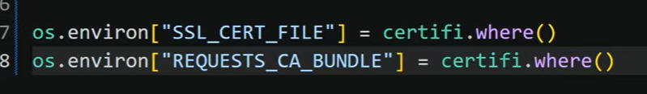

# TRIPSORT - A Multi-Agent Travel Planner

## Setup with Conda
1. Create a new conda environment:

```bash
conda create -p venv python=3.12
```
2. Activate the environment:

```bash
conda activate ./venv
```
3. Install the required dependencies:

```bash
pip install -r requirements.txt
```

